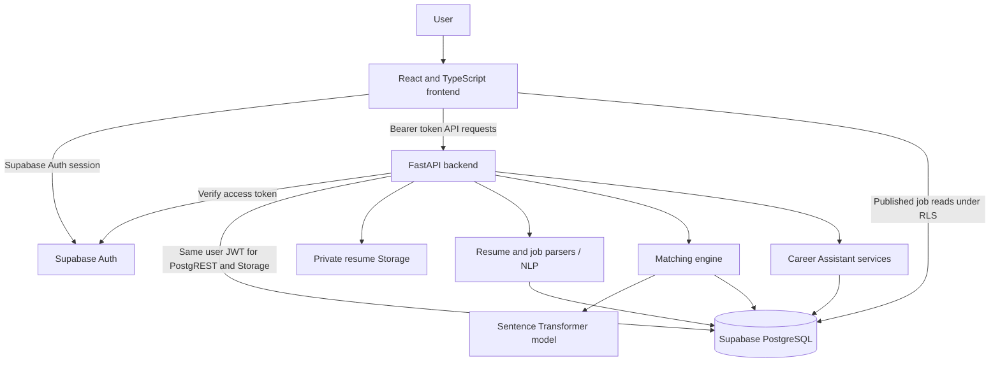

# System Architecture

## Overview

## Layer responsibilities

### React frontend

Provides public landing and authentication pages, recruiter routes, job seeker resume tools, application submission, match/explanation views, and Career Assistant workflows. It sends the Supabase access token to protected API routes. Published-job reads use the authenticated Supabase client and remain subject to database RLS. The frontend contains only the Supabase publishable key, never a service-role key.

### FastAPI backend

Owns validation and orchestration for resume uploads, job-description analysis and management, candidate application, matching, ranking explanations, recruiter workspace operations, and Career Assistant requests. `require_current_user` verifies bearer tokens against Supabase Auth. Data operations use the caller's JWT so PostgreSQL and Storage policies still apply; there is no service-role bypass.

### Resume and job NLP

PDF and DOCX parsers extract text, then deterministic cleaners, section detectors, and extractors produce structured profiles. Upload size/type checks run before parsing. OCR is not implemented; unreadable/image-only documents return errors rather than inferred content.

### Matching engine

Uses `sentence-transformers/all-MiniLM-L6-v2` by default for semantic similarity and deterministic component scores for skill coverage, experience, education, and project relevance. The existing weighted overall score is 40% semantic, 25% skills, 15% experience, 10% education, and 10% projects. Scores and the supporting components are persisted; Task 7 explanations are derived from those saved results and extracted evidence.

### Career Assistant

Reads the signed-in job seeker's own resume profile and, where requested, published job data or supplied role criteria. Resume review and skill/interview workflows use deterministic rules and templates. Chat responses are also templated; no generative AI provider is configured. User messages and sessions are scoped to the authenticated candidate.

### Supabase data and storage

Supabase Auth owns identity and issues access tokens. PostgreSQL stores profiles, jobs, resumes, profiles, screening results, recruiter workspace records, and assistant sessions/messages. RLS protects table access. Resume files are stored in the private `talentiq-resumes` bucket, under candidate-owned paths; recruiter access is granted only after an application and only for the recruiter who owns that job.

## Trust boundaries

- Frontend route guards improve navigation but are not authorization controls.
- FastAPI validates identity and role; database RLS and service-level ownership checks remain authoritative.
- An application is the consent link allowing the owning recruiter to access a candidate's resume/profile for that job.
- No demo mode disables auth, bypasses ownership, disables RLS, or writes sample production data.
